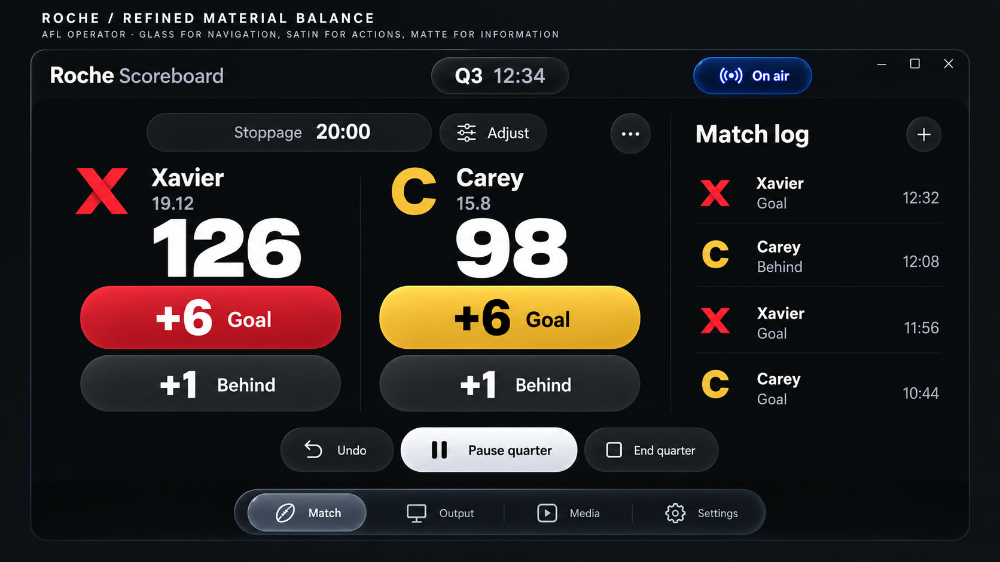
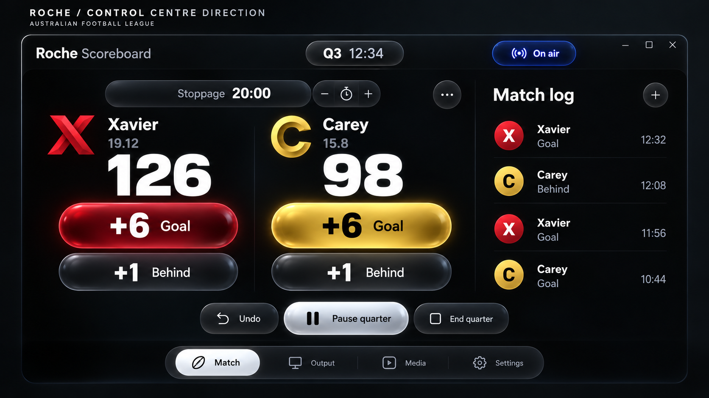
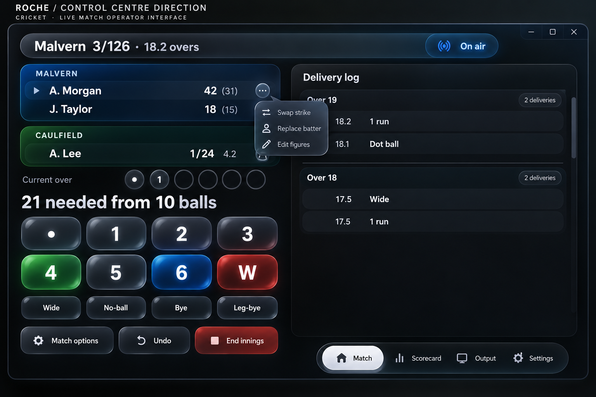
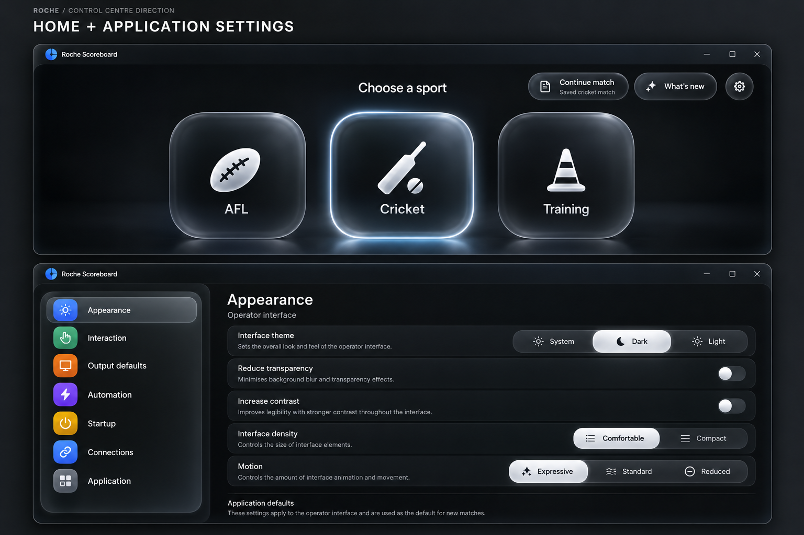
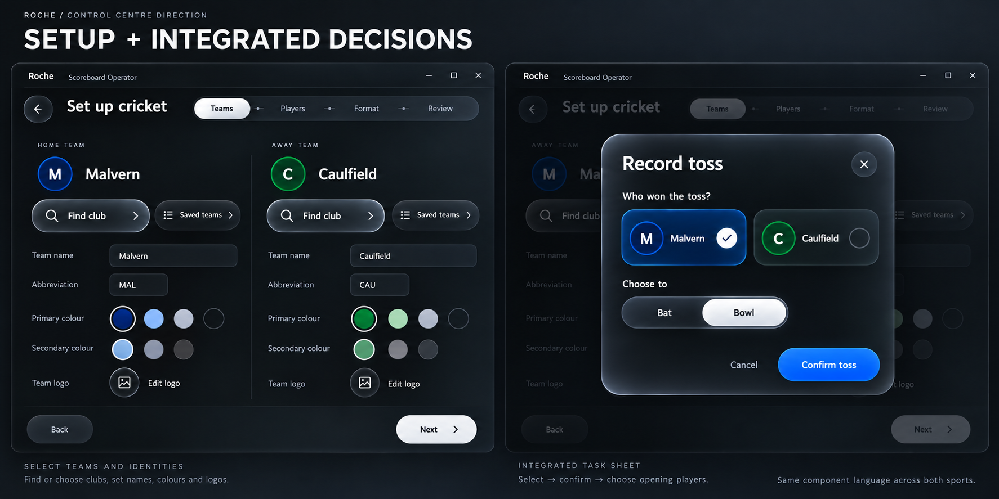
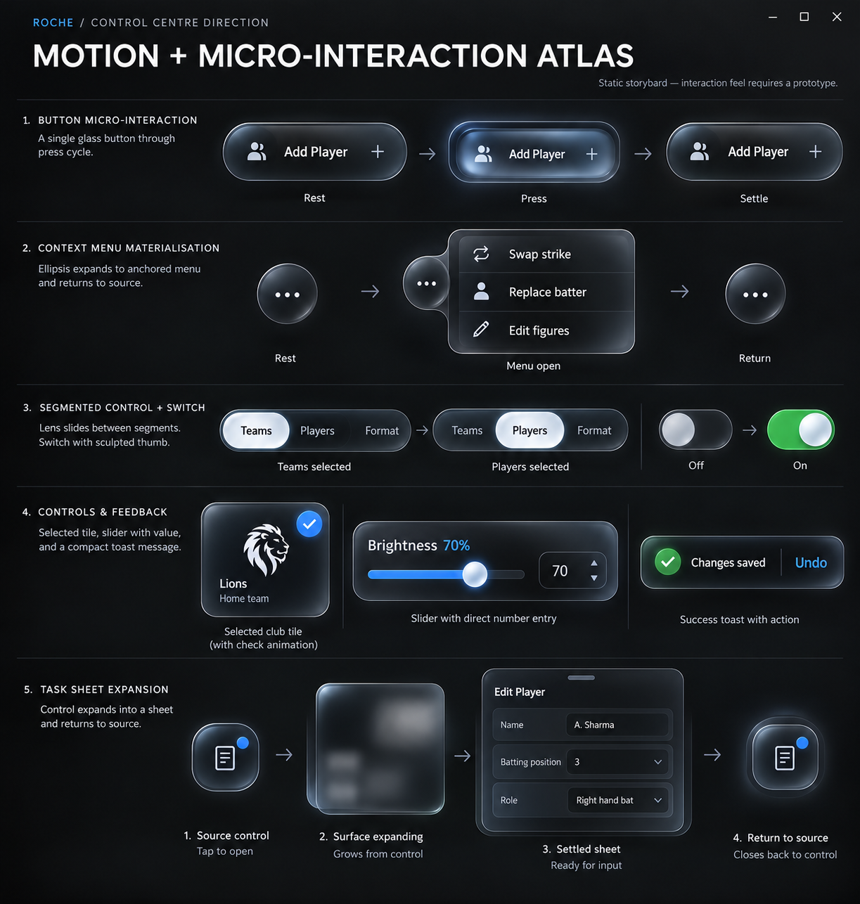

# 08 — Revised Control Centre concept boards

These are generated visual proposals, not application screenshots or functioning prototypes. The user selected a bolder iOS Control Centre direction after the first understated concepts. Only the revised operator boards below belong to the current proposal. No public-output concept is included.

The material is intentionally conspicuous so its character can be reviewed. Actual intensity, contrast, text metrics and animation must be tuned in a later interactive Windows prototype. The written behaviour/scope specifications take precedence over incidental generated labels or geometry.

## Latest refinement: quieter material balance

Following review, retain the Apple direction and floating navigation but reduce glass on routine buttons and panels. This revised study uses matte information, satin scoring actions and selective glass floating tools. It supersedes the all-gloss intensity of the earlier AFL board below; apply the same material policy across sports. Exact header/dock heights remain prototype decisions. See [11 Review refinement](11-review-refinement-and-first-demonstration.md).

## 1. AFL live operator

Review the paired scoring targets, bold hierarchy, sculpted team actions, calm bounded history and floating navigation. Illustrative monograms are not replacement club assets. The generated stoppage minus/plus glyphs are not a proposed new adjustment mechanism: retain one Adjust action and the existing editor. Team totals and Goal/Behind functions are unchanged domain operations.

## 2. Cricket live operator

Review the shared material family, familiar Dot/1/2/3 then 4/5/6/W keypad, player context and anchored menu. The exact dock position should be unified with the AFL shell in a prototype; its apparent right alignment here is illustrative, not a separate navigation rule. Historical rows represent a filtered fragment, not a complete innings dataset. End innings is a neutral consequential navigation action; reserve a stronger red destructive treatment for an actual destructive confirmation, regardless of its red fill in this illustration.

## 3. Home and application settings

Review stronger sporting tiles, utility capsules, coloured settings categories, grouped preferences and white selected lenses. Home shows the saved-match entry AFTER Continue later; do not show it behind the initial recovery prompt. The highlighted Cricket tile represents interaction/focus, not a mode that has already started. Categories and preferences reflow at compact widths rather than scaling this bitmap.

## 4. Setup and integrated decisions

Review symmetric team editors, Find club hierarchy, selected team treatment and the common integrated sheet. The sheet study is juxtaposed with a wizard background to show the material; Record toss remains in the live cricket workflow after setup, not a new wizard step. Existing logo assets/colour picker functionality remain authoritative; the pictured circles are illustrative editor affordances, not a reduction of available colours.

## 5. Motion and micro-interaction atlas

Review press depth, source-connected menu expansion, travelling selection lenses, switches, selected checks and returning task surfaces. This is a static storyboard. It cannot demonstrate springs, frame pacing, interruption, focus or response latency. The generated Press inset must NOT become a second rectangular focus/selection outline: one material silhouette is required. Generic editor fields and the illustrative Lions mark are not additional product features or bundled assets.

## Review authority

- Visual/material and responsive contract: [09 Control Centre direction](09-control-centre-direction.md).
- Timing, state, VFX and reduced-mode contract: [10 Motion specification](10-motion-vfx-specification.md).
- Complete functional screen families: [02 Coverage](02-navigation-and-coverage.md) and [04 Behaviour](04-screen-specifications.md).
- Exact generation prompts: [Concept prompts](concept-prompts.md).

The earlier public-display exploration is withdrawn and not an implementation reference. All existing output windows and their presentation/effect behaviour remain outside this task.
